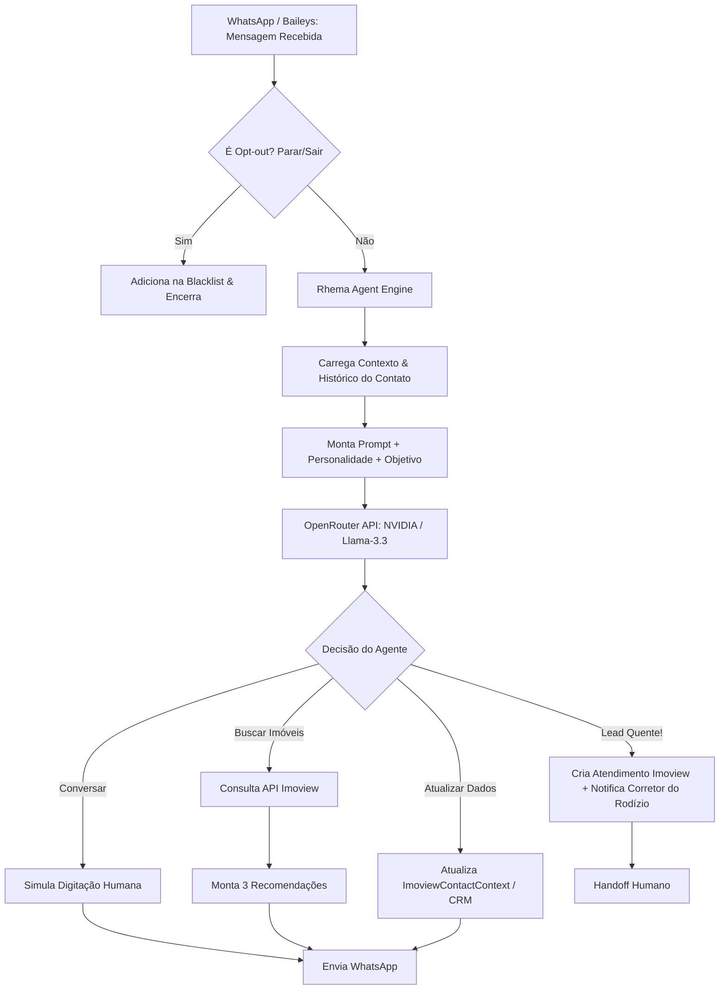

# 🤖 Transformação Agêntica Rhema: Do Chatbot Estático ao Agente de IA Autônomo com OpenRouter (NVIDIA)

> **Documento de Arquitetura & Expansão Estratégica**  
> **Status:** Proposta & Estudo de Viabilidade (Nenhuma alteração de código aplicada)  
> **Target:** Rhema Imóveis / WhatsApp Gateway (`WA-AKG`)  

---

## 1. Diagnóstico: O Que Temos Hoje vs. O Que É um Agente Real

Atualmente, o módulo de atendimento do sistema em [`autoreply.ts`](file:///c:/Users/brunn/OneDrive/Documentos/Sistemas/Whatsapp%20Auto/src/modules/whatsapp/store/autoreply.ts) e [`command-handler.ts`](file:///c:/Users/brunn/OneDrive/Documentos/Sistemas/Whatsapp%20Auto/src/modules/whatsapp/bot/command-handler.ts) opera como um **Chatbot Baseado em Regras e Gatilhos Simples**:
* Responde apenas se bater com uma palavra-chave exata ou regex (ex: `#ping`, `#sticker`, palavra "preço").
* **Não tem memória contextual:** não lembra o que o cliente disse há 2 mensagens.
* **Não tem capacidade de raciocínio:** não entende gírias, áudios, desabafos ou frases indiretas ("já vendi ano passado", "me chama mês que vem", "estou procurando algo perto da praia até 500 mil").
* **Não tem braços (Tools/Actions):** não sabe consultar uma API para recomendar imóveis, nem criar um card de atendimento no Imoview sem ação humana.

### A Mudança para um "Agente Autônomo" (Agentic Workflow)
Um **Agente de IA** não é um mero gerador de texto. Ele possui **4 pilares fundamentais**:
1. **Percepção e Memória:** Conhece o contexto do lead (histórico de conversas, se é proprietário ou comprador, qual campanha recebeu).
2. **Capacidade Cognitiva (LLM via OpenRouter):** Interpreta intenções sutis em linguagem natural e decide qual é o próximo passo ideal.
3. **Ferramental (Function Calling / Tool Use):** Tem permissão para consultar o banco de dados, buscar imóveis no Imoview, atualizar cadastros e disparar alertas no WhatsApp dos corretores.
4. **Autonomia com Salvaguardas:** Age 24/7, mas sabe a hora exata de parar e transferir para um humano (Handoff) quando identifica calor de fechamento ou insatisfação.

---

## 2. Viabilidade do OpenRouter & Modelos Gratuitos da NVIDIA

A resposta para a sua dúvida é **SIM, é 100% viável e muito vantajoso**, inclusive utilizando os modelos da NVIDIA no OpenRouter:

### Modelos NVIDIA / Gratuitos Recomendados no OpenRouter:
* `nvidia/llama-3.1-nemotron-70b-instruct` *(ou versões Free)*: Modelo ajustado pela NVIDIA para conversas naturais e excelente precisão de raciocínio lógico.
* `meta-llama/llama-3.3-70b-instruct:free`: Um dos modelos abertos mais inteligentes do mundo hoje, altamente capaz de seguir instruções complexas em português e retornar **JSON estruturado (Function Calling)**.
* `meta-llama/llama-3-8b-instruct:free` ou `qwen/qwen-2.5-7b-instruct`: Ideais para tarefas ultra-rápidas de baixa latência (ex: apenas classificar a intenção do cliente em 0.5s antes de mandar pro agente maior).

### Como funciona no OpenRouter:
* A API do OpenRouter é **100% compatível com a SDK padrão da OpenAI** (`baseURL: "https://openrouter.ai/api/v1"`).
* Permite alternar modelos trocando apenas uma string (ex: de `nvidia/...` para `meta-llama/...` ou até Claude/GPT no futuro se desejar pagar por casos críticos), sem alterar uma única linha da lógica de negócio.
* Suporta **Structured Outputs / JSON Schema**, essencial para extrair cadastros e preencher tabelas.

---

## 3. Arquitetura Proposta: O "Rhema Agent Core"

### O Conceito de Ferramentas (Tool Calling) do Agente:
O modelo não apenas fala; ele pode chamar funções internas do sistema:
1. `atualizar_dados_proprietario({ statusImovel, valorPretendido, aceitaFinanciamento, observacoes })`
2. `buscar_imoveis_por_perfil({ tipo, bairro, valorMax, quartos, finalidade })`
3. `criar_atendimento_e_atribuir_corretor({ nome, telefone, codigoImovel, resumoInteresse })`
4. `transferir_para_humano({ motivo, urgencia })`

---

## 4. Detalhamento dos 3 Grandes Casos de Uso

---

### CASO DE USO 1: O Agente Atualizador de Cadastro de Proprietários
**Cenário:** Você faz um broadcast pelo sistema para 300 proprietários de imóveis parados ou antigos.
* **Mensagem inicial (Disparo):**
  > *"Olá Sr. Marcos, tudo bem? Aqui é a Amanda da Rhema Imóveis. Estamos revisando nosso catálogo de imóveis no Gonzaga e gostaria de saber se o seu apartamento no Edifício Solar ainda continua disponível para venda ou se houve alteração no valor?"*

* **Comportamento do Agente Autônomo:**
  1. **Proprietário responde em áudio ou texto solto:** *"Oi Amanda, tudo bem. Olha, eu resolvi abaixar pra 480 mil porque quero vender logo, mas o condomínio subiu pra 650. Pode continuar anunciando sim."*
  2. **Interpretação do Agente:** O modelo compreende a linguagem informal e aciona silenciosamente:
     * `status: "DISPONIVEL"`
     * `novoValor: "480000"`
     * `novoCondominio: "650"`
     * `temperatura: "ALTA_MOTIVACAO_VENDA"`
  3. **Ação no Sistema:**
     * Atualiza a tabela [`ImoviewContactContext`](file:///c:/Users/brunn/OneDrive/Documentos/Sistemas/Whatsapp%20Auto/prisma/schema.prisma) no banco de dados local.
     * Grava uma ocorrência no Imoview via [`recordImoviewInteraction()`](file:///c:/Users/brunn/OneDrive/Documentos/Sistemas/Whatsapp%20Auto/src/lib/imoview.ts).
     * Se o imóvel baixou de valor significativamente, notifica o captador: *"🔔 O proprietário Marcos atualizou o imóvel 1234 para R$ 480.000! Oportunidade para sua carteira."*
  4. **Resposta Humanizada do Agente:**
     > *"Perfeito, Sr. Marcos! Já atualizei o valor para R$ 480.000 e o condomínio aqui na nossa base para que nossos corretores trabalhem com as informações certinhas. Qualquer novidade ou proposta, te aviso imediatamente. Tenha uma ótima semana!"*

* **Caso o proprietário diga que já vendeu:**
  * O agente pergunta educadamente se foi através de outra imobiliária ou direto, agradece cordialmente, atualiza a situação para `"VENDIDO_TERCEIROS"` e evita que a Rhema continue gastando tempo ou passando constrangimento com anúncios desatualizados.

---

### CASO DE USO 2: Agente de Resgate & Requalificação de Leads Frios/Parados
**Cenário:** Milhares de leads parados no Imoview sem contato há mais de 30/60 dias.

* **Objetivo do Agente:** Reengajar sem parecer um bot de telemarketing chato.
* **Abordagem Estratégica:**
  * Abordagem consultiva, referenciando o que ele procurava no passado:
    > *"Oi Fernando, tudo bem? Vi aqui que em novembro você estava pesquisando apartamentos de 2 quartos no Boqueirão com a gente. Sei que achar o imóvel ideal às vezes leva tempo... você ainda está nessa busca ou já conseguiu encontrar o seu lar?"*
* **Árvore de Decisão do Agente:**
  * **Se o Lead disser "Já comprei":** O agente parabeniza com elegância, marca o lead como `COMPRADO` no Imoview e limpa a fila.
  * **Se o Lead disser "Ainda estou procurando, mas desanimei dos preços":**
    * O agente faz 1 a 2 perguntas de diagnóstico rápido: *"Entendo perfeitamente, o mercado deu uma oscilada. Qual seria o teto de valor que faria sentido para você hoje?"*
    * Requalifica orçamento, modalidade (à vista/financiamento) e urgência.
    * **Ativação:** Avisa o lead que um corretor especialista selecionou novidades e transfere para a fila do rodízio.

---

### CASO DE USO 3: SDR Imobiliário 24/7 (Inbound de Portais, Anúncios e Site)
**Cenário:** O lead clica num anúncio do Instagram/VivaReal às 23:45 de um domingo. O tempo de resposta médio das imobiliárias é de 6 a 12 horas (quando o lead já esfriou).

* **Tempo de Resposta do Agente:** Menos de 45 segundos.
* **Fluxo de Atendimento do SDR:**
  1. **Boas-vindas Humanizadas:**
     > *"Oi Juliana! Tudo bem? Aqui é a assistente virtual da Rhema Imóveis. Recebi seu interesse no apartamento no Embaré (Cód. 8421). Como posso te ajudar melhor sobre ele?"*
  2. **Interação e Descoberta de Perfil:**
     * Juliana pergunta: *"Ele tem vaga demarcada? Aceita permuta?"*
     * O agente consulta a ficha do imóvel no catálogo do Imoview e responde com precisão.
  3. **Recomendação Proativa (Até 3 Imóveis):**
     * Juliana comenta: *"Gostei, mas queria ver se tem algo parecido com sacada gourmet até 750 mil."*
     * O agente aciona a função `buscar_imoveis_por_perfil({ bairro: "Embaré/Aparecida", valorMax: 750000, tipo: "Apartamento" })` consumindo [`fetchImoviewProperties()`](file:///c:/Users/brunn/OneDrive/Documentos/Sistemas/Whatsapp%20Auto/src/lib/imoview.ts).
     * O agente seleciona até **3 opções perfeitas** e envia de forma elegante:
       > *"Juliana, além desse do Embaré, temos 3 opções incríveis que acabaram de entrar no nosso acervo com sacada gourmet nessa faixa:
       > 
       > 1️⃣ **Apto 2 dorms no Embaré** (Cód 8920) - R$ 720.000, sacada envidraçada e lazer completo.
       > 2️⃣ **Apto 3 dorms na Aparecida** (Cód 8112) - R$ 745.000, 2 vagas privativas.
       > 3️⃣ **Apto reformado no Boqueirão** (Cód 7804) - R$ 690.000 com churrasqueira a carvão.
       > 
       > Algum desses chama mais a sua atenção para eu te mandar as fotos e agendarmos uma visita?"*
  4. **Criação do Atendimento & Distribuição do Rodízio:**
     * Assim que o lead demonstra intenção real de visita ou interesse sério:
       * Cria automaticamente o Atendimento no Imoview.
       * Consulta a regra de rodízio de corretores (ou equipe de plantão).
       * Envia um resumo no WhatsApp do corretor sorteado:
         > *"🚨 NOVO LEAD QUALIFICADO (SDR 24/7)  
         > **Cliente:** Juliana Mendes  
         > **Telefone:** (13) 99123-XXXX  
         > **Interesse:** 2 a 3 quartos com sacada gourmet até 750k  
         > **Imóvel Gancho:** Cód 8421 / 8920  
         > **Status:** Aguardando envio de fotos/agendamento de visita.  
         > Assuma a conversa agora pelo WhatsApp da Rhema!"*
       * Faz o handoff suave avisando a cliente que o corretor [Nome do Corretor] já está assumindo.

---

## 5. Superpoderes de IA Adicionais para o Sistema Atual

Além dos 3 agentes acima, a introdução do OpenRouter permite transformar o broadcast e o pós-disparo:

### 1. Hiperpersonalização de Broadcast em Tempo Real (Anti-Spam Semântico)
* Em vez de usar apenas spintax simples `{Olá|Oi|Tudo bem}`, a IA pode gerar variações dinâmicas do texto com base no perfil de cada contato antes do envio.
* Isso **reduz o risco de banimento do WhatsApp em até 80%**, porque cada mensagem enviada possui estrutura de frase, vocabulário e pontuação únicos, parecendo 100% manual e orgânico.

### 2. Classificação Automática de Respostas (Lead Sentiment Analysis)
* Quando você dispara 500 mensagens, sua equipe não precisa ler 500 conversas.
* O agente categoriza as respostas recebidas em tags visíveis no Dashboard:
  * 🟢 **Quente / Interessado:** Quer visitar, pediu valor, tem pressa.
  * 🟡 **Morno / Dúvida:** Fez pergunta sobre documentação, quer mais fotos.
  * 🔴 **Descarte / Não tem interesse:** Já comprou, não quer contato.
  * ⛔ **Opt-out:** Pediu para não mandar mais mensagem (vai pra blacklist automático).

### 3. Simulação de Comportamento Humano Genuíno
* O agente não responde em 0.2 segundos como um bot frio.
* Ele envia o status de presença `"composing"` (digitando...) no WhatsApp durante 3 a 7 segundos proporcionais ao tamanho da mensagem antes de enviar, gerando a sensação de atendimento por uma pessoa real.

---

## 6. O Que Precisaria Ser Adicionado na Estrutura do Projeto?

Sem alterar nada agora, veja como isso se encaixaria com precisão cirúrgica na arquitetura existente:

### No Banco de Dados (`schema.prisma`):
1. **`AgentConfig`**: Configurações do agente por sessão (API Key OpenRouter, modelo escolhido ex: `nvidia/llama-3.1-nemotron-70b-instruct`, tom de voz, regras de negócio).
2. **`AgentConversation` & `AgentMessage`**: Histórico das últimas mensagens trocadas para alimentar o contexto do prompt.
3. **`AgentState` / Status do Lead**: Status atual (`QUALIFICANDO`, `AGUARDANDO_RESPOSTA`, `TRANSFERIDO_HUMANO`, `CONCLUIDO`).

### No Backend Next.js (`src/lib` e `src/modules`):
1. **`src/lib/ai/openrouter-client.ts`**: Cliente de conexão com OpenRouter compatível com streaming e function calling.
2. **`src/lib/ai/agent-orchestrator.ts`**: O cérebro que decide qual agente responder (Proprietário, Resgate ou SDR) com base na origem do contato.
3. **`src/lib/ai/agent-tools.ts`**: As funções conectadas diretamente aos métodos já existentes em [`src/lib/imoview.ts`](file:///c:/Users/brunn/OneDrive/Documentos/Sistemas/Whatsapp%20Auto/src/lib/imoview.ts) (`fetchImoviewProperties`, `recordImoviewInteraction`).
4. **Hook no Listener do WhatsApp**: Em [`autoreply.ts`](file:///c:/Users/brunn/OneDrive/Documentos/Sistemas/Whatsapp%20Auto/src/modules/whatsapp/store/autoreply.ts), se a mensagem recebida for de uma conversa ativa com o Agente, direciona para o `agent-orchestrator` em vez do chatbot estático.

---

## 7. Próximos Passos & Estratégia de Teste (Custo Zero)

Como você pretende testar com os **modelos gratuitos da NVIDIA no OpenRouter**, o caminho ideal sugerido é:

1. **Fase 1: Sandbox de Testes (Sem tocar no WhatsApp real)**
   * Criar uma tela simples no painel ou script de teste onde possamos simular uma conversa com o Agente da NVIDIA via OpenRouter, fingindo ser um proprietário ou um lead interessado, para calibrar os prompts e as saídas em JSON.
2. **Fase 2: Teste Controlado com 1 Chip / Sessão Piloto**
   * Ativar o agente apenas para 1 número específico (ex: número da equipe ou um chip secundário) com o caso de uso de **Atualização de Proprietários**.
3. **Fase 3: Expansão para SDR 24/7 e Resgate de Leads**
   * Integrar com a fila do rodízio do Imoview e abrir para novos anúncios.

---
*Este documento foi gerado para planejamento e alinhamento conceitual. O código existente permanece intacto.*
